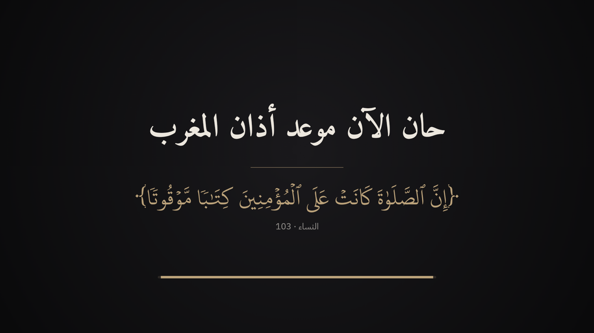
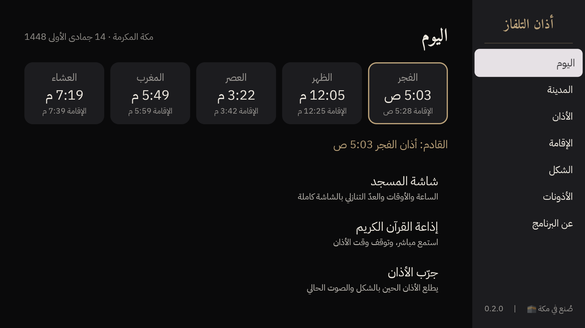
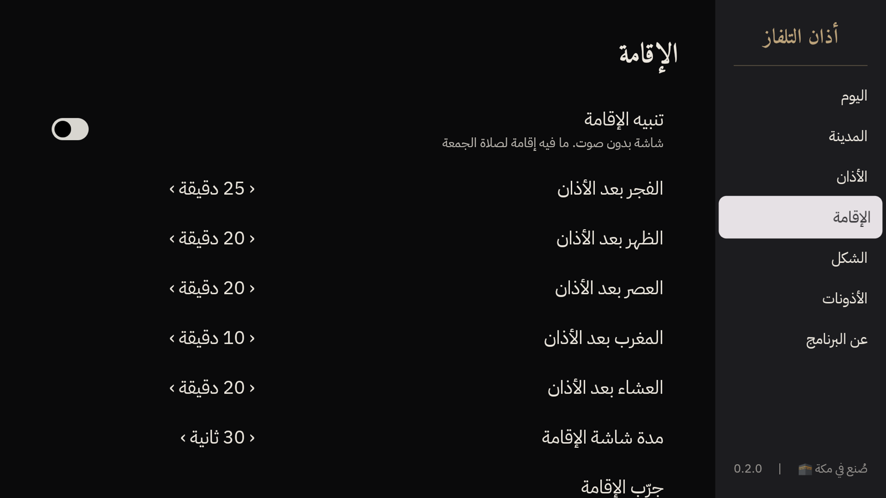

<div dir="rtl">

# أذان التلفاز

برنامج مجاني ومفتوح المصدر لتلفزيونات Android TV و Google TV. يعرض الأذان والإقامة على الشاشة في وقتها بالضبط، فوق أي شي شغّال، مع صوت إذاعة القرآن الكريم أو أذان مسجّل. بدون إعلانات، وبدون حسابات، وبدون أي سيرفر.



## وش يسوي

- يحسب أوقات الصلاة بنفسه وبدون نت، على تقويم أم القرى (الرسمي في السعودية) أو طرق الحساب الثانية.
- وقت الأذان: شاشة كاملة بخط مجمع الملك فهد، وآية عن الصلاة، وخط يقصر لين تخلص الشاشة.
- يوقف الفيديو اللي كان شغّال، ويخليه واقف بعد الأذان.
- الصوت: إذاعة القرآن الكريم مباشر في مكة والرياض، والأذان المسجّل من الحرم في باقي المدن. لو ما فيه نت يشتغل المسجّل.
- الإقامة: شاشة بدون صوت. الافتراضي المعتاد في مساجد السعودية: الفجر 25، الظهر 20، العصر 20، المغرب 10، العشاء 20 دقيقة.
- يوم الجمعة: «أذان الجمعة» بدون تنبيه إقامة.
- لو التلفزيون مطفي ما يسوي شي، ولا يشغّله.
- كل الإعدادات بالريموت: الصلوات، والصوت، والمدد، والألوان، والحجم، والإيقاف المؤقت.

<p>


</p>

## التنزيل على التلفزيون

**قريباً على متجر Google Play.** وإلى ذلك الوقت تنزّله من GitHub:

1. من متجر Google Play في التلفزيون، نزّل برنامج **Downloader** (من AFTVnews).
2. افتح الإعدادات ← التطبيقات ← الوصول الخاص ← «تثبيت تطبيقات غير معروفة»، وفعّل **Downloader**.
3. افتح Downloader واكتب رابط آخر نسخة من صفحة [Releases](../../releases/latest) (ملف `.apk`)، واضغط تنزيل ثم تثبيت.
4. افتح «أذان التلفاز» من قائمة التطبيقات، واختر مدينتك، وفعّل «الظهور فوق التطبيقات» من قسم الأذونات.

أو من الكمبيوتر بكيبل الشبكة (وضع المطوّر مفعّل في التلفزيون):

<div dir="ltr">

```sh
adb connect <TV-IP>:5555
adb install -r adhan-tv.apk
```

</div>

### تبغى تجرّبه قبل المتجر؟

Google يطلب من الحسابات الجديدة **12 مختبر على الأقل لمدة 14 يوم متواصلة** قبل النشر في المتجر. لو عندك تلفزيون Android TV أو Google TV وتبغى تساعد، افتح [Issue](../../issues/new) بعنوان «أبغى أجرّب»، ونضيفك للاختبار المغلق.

### أذانك الخاص

تقدر تحط أي أذان تحبه (لاستخدامك الشخصي) في التلفزيون، وكل ملف يظهر في الإعدادات باسمه:

<div dir="ltr">

```sh
adb push "المكي.mp3" /sdcard/Android/data/app.adhantv/files/
```

</div>

## الأذونات

| الإذن | ليش | لازم؟ |
|---|---|---|
| الظهور فوق التطبيقات | عشان تطلع شاشة الأذان فوق يوتيوب والقنوات | اختياري. بدونه يطلع الأذان لما يكون البرنامج مفتوح بس |
| المنبهات والتذكيرات | عشان يطلع الأذان في ثانيته | مفعّل افتراضياً في أغلب التلفزيونات |
| الموقع التقريبي | يطلب مرة وحدة لما تضغط «حدّد مدينتي» | اختياري. والموقع ما يطلع من التلفزيون |
| الإنترنت | لصوت الإذاعة بس | — |

### تلفزيونات TCL

نظام TCL يمنع البرامج تصحى لحالها. لازم تسمح للبرنامج بالتشغيل التلقائي، وإلا ما يطلع الأذان:

<div dir="ltr">

```sh
adb shell appops set app.adhantv APP_AUTO_START allow
adb shell appops set app.adhantv APP_ASSOC_START allow
adb shell appops set app.adhantv SYSTEM_ALERT_WINDOW allow
```

</div>

## المصادر

كل المحتوى من مصادره الأصلية، والتفاصيل في [CREDITS.md](CREDITS.md):

- الخط ونص الآيات: مجمع الملك فهد لطباعة المصحف الشريف، الملف الأصلي بدون تعديل.
- الأوقات: مكتبة [adhan](https://github.com/batoulapps/adhan-kotlin) (MIT)، مطابقة لتقويم أم القرى الرسمي بفرق دقيقة كحد أقصى (فيه اختبارات).
- الأذان المسجّل: أذان المغرب في المسجد الحرام، CC BY 3.0.
- المدن: GeoNames، CC BY 4.0.

## كيف انبنى

انبنى البرنامج بمساعدة [Claude Code](https://claude.com/claude-code) من Anthropic. الكود مرتّب وموثّق، وكل قرار مشروح في `docs/research`، فتقدر تعدّل عليه بنفسك أو بمساعدة Claude Code: افتح الريبو واطلب التعديل اللي تبغاه بالعربي.

## صدقة جارية

هذا البرنامج صدقة جارية عن صاحبه وأسرته، وعن كل من ساهم فيه، إلى يوم الدين.

صُنع بإحسان في مكة المكرمة، بواسطة زياد مياجان.

## الرخصة

[MIT](LICENSE): تقدر تستخدمه وتعدّله وتنشره بحرية. للخطوط والمحتوى رخصها الخاصة في مجلد [licenses](licenses)، ومنها إن خط المصحف ما يتعدّل ولا يُباع.

</div>

---

## English

**Adhan TV** is a free, open-source, ad-free Android TV / Google TV app that shows the adhan and iqama full-screen at the exact time, over whatever is playing. Prayer times are computed offline (Umm al-Qura by default, via [batoulapps/adhan-kotlin](https://github.com/batoulapps/adhan-kotlin)); the sound is the live Saudi Quran Radio in Makkah and Riyadh and a bundled CC BY 3.0 recording from al-Masjid al-Haram elsewhere. The playing video is paused and stays paused. Everything is configurable with the remote.

### Build

```sh
./gradlew :core:prayer:test assembleDebug
adb install -r app/build/outputs/apk/debug/app-debug.apk
```

Requirements: JDK 17+ to run Gradle (a Java 21 toolchain is downloaded automatically for `:core:prayer`), Android SDK with platform 37.

### Layout

| Path | What |
|---|---|
| `core/prayer` | Pure Kotlin/JVM: prayer times, iqama, the next-event schedule. Unit-tested against official Umm al-Qura times. |
| `app` | Android TV app (Compose for TV): settings, alarms, adhan screen, audio. |
| `app/src/debug` | Debug-only test trigger: `adb shell am broadcast -a app.adhantv.TEST -n app.adhantv/.schedule.TestReceiver --ei delay 60 --ei seconds 30` |
| `tools` | Scripts that build the bundled data (cities, verses, adhan audio, icons) from their original sources. |
| `docs/research` | Research notes behind each decision (licensing, Play policy, prayer times, architecture, audio). |

### How it was built

Built with the help of [Claude Code](https://claude.com/claude-code). The code is small, documented, and every decision is explained in `docs/research`, so it is easy to change — by hand or by asking Claude Code.

### License

MIT. Fonts and content keep their own licences (the KFGQPC font may not be modified or sold); see [CREDITS.md](CREDITS.md) and [licenses/](licenses).
